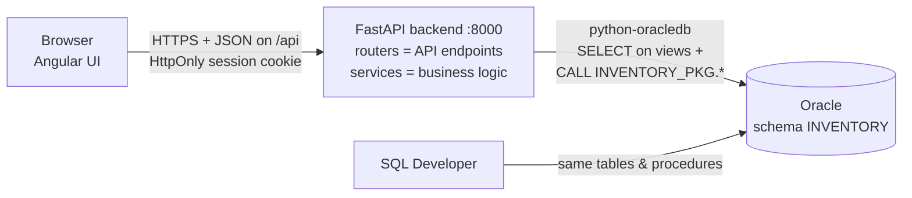

# StockSmart: Inventory Management System

An Information Systems course project built as a **3-tier web application**.

## The business: StockSmart Retail
An **omnichannel general-merchandise retail chain** in India: one company selling everyday products from many
categories through its **10 outlets** and its **online shop** (customers order online from their nearest outlet).

| | |
|---|---|
| Products | 89 products (SKUs) in 8 categories: Electronics, Stationery, Home & Kitchen, Apparel, Sports & Fitness, Beauty & Personal Care, Books, Toys & Games |
| Outlets | Mumbai, Pune, Bengaluru, Delhi (warehouse), Chennai, Hyderabad, Kolkata, Ahmedabad, Jaipur, Kochi |
| Suppliers | 12 wholesalers / brands |
| Customers | 50,000 registered online customers in 18 cities (large data set) |
| Sales | about 89,000 orders, Jan 2025 – Nov 2026, with a festive peak in Oct–Nov |
| Staff | Administrator, store manager, warehouse staff |

Why it needs this system: many products across many categories, stock spread over 10 locations, different suppliers,
and customers ordering online, so stock must be correct per outlet at every moment.

## What type of system it is
| Classification | This project |
|---|---|
| How stock is tracked | **Perpetual** inventory: every sale, cancel, return, restock, adjustment and transfer updates stock immediately (not counted once a month) |
| Locations | **Multi-location**: stock per outlet, totals across outlets, transfers between them |
| Scope | **Inventory + order management** (catalogue, stock, orders, payments, deliveries); not a full ERP (no accounting / HR) |
| Information-system level | **TPS** (transaction processing: orders, payments, stock movements, each one all-or-nothing) **+ MIS** (dashboard, low-stock alerts, quarterly reports with charts and Excel/CSV download). **DSS** features (forecasting, reorder suggestions, what-if) are possible future work |
| Users | **B2C** customers + internal staff, with role-based access |
| Architecture | Web-based, client–server, **3-tier**, one central relational database |

| Tier | Technology | What it does | Folder |
|---|---|---|---|
| Presentation (UI) | Angular 19 (TypeScript, SCSS, Chart.js) | Screens and forms; calls the REST API | `frontend/` |
| Application | Python FastAPI | **REST API + all business logic** (rules, permissions, payment, workflow) | `backend/app/` |
| Data | **Oracle Database** (21c or 26ai Free) | Tables and constraints, **stored procedures** (data operations), **triggers**, views | `database/` |



**Who does what**
- **Angular** shows the data and sends requests to `/api/...`. Every endpoint it uses is listed in one file, `frontend/src/app/core/api.service.ts`.
- **Python (FastAPI)** receives the request, checks the login and the user's **permission**, applies the **business rules** in `backend/app/services/` (is there enough stock, may this order still be cancelled, did the payment succeed, which delivery step is next ...) and runs the whole action as **one database transaction**.
- **Oracle** stores the data and protects it with constraints. The PL/SQL package `INVENTORY_PKG` holds the **data operations** that Python calls (lock a stock row, apply a stock change, create an order, set a payment status ...). **Triggers** write the stock audit log and keep the "last updated" times correct automatically.

## Features

**Customer**
- Sign up with personal details (phone, address, PIN code, nearest outlet), log in by typing email and password
- Browse an outlet's products **with photos** and live stock; search, filter by category, **sort** by name, price or newest
- Cart and checkout: stock is reserved straight away, so it can't be oversold
- Payment gateway (card, UPI or net banking) with decline handling and retry
- My orders: **sort by latest update**, filter by status and by "updated today / last 7 / 30 days"; cancel before shipping
- My profile: edit details, see own profiles and permissions

**Staff** (what each one sees depends on their profile)
- Dashboard: revenue, orders waiting to ship, pending payments, low-stock alerts
- Inventory: stock **per outlet** and **collective**; restock, adjust, transfer; movement log with *who* changed what
- Products: create, edit, hide; Orders: delivery status, courier, tracking, returns, cancel
- Every list can be **sorted** (latest updated, newest, amount, quantity, name ...), filtered by **"updated within"**, and cleared with **Reset filters**
- Pop-up confirmations, e.g. "Order #238: delivery status updated to Out for delivery"
- **Quarterly reports** (choose year and quarter): totals (orders, units, revenue), charts of revenue **by outlet**,
  **by month** and **by category**, top products and current stock per outlet; downloadable as **Excel** (one sheet per
  section) **or CSV** by anyone with the `REPORT_DOWNLOAD` permission (admin, store manager)
- **Users & access** (admins): all registered users with their profiles, create staff accounts, change profiles, disable or unlock accounts, and the full **authorization matrix**

**Security**
- Login session in an **HttpOnly, Secure, SameSite=Strict cookie**: page scripts can't read it, it only travels over HTTPS, and other websites can't make the browser send it
- **CSRF protection**: data changes also need the `X-Requested-With` header
- **Security headers**: Content-Security-Policy, X-Frame-Options, X-Content-Type-Options, Strict-Transport-Security, Referrer-Policy, Permissions-Policy
- **Role-based access control** from the database (profiles → permissions), checked on every request
- bcrypt password hashes; **account lock** for 15 minutes after 5 wrong passwords; disabled accounts can't log in

## Large dataset (50,000 customers)

[`database/dataset/`](database/dataset/README.md) has one CSV file per table (16 files): 50,000 customers with their profiles, 89,260 orders, 172,140 order items, 192,254 stock movements, covering Jan 2025 – Nov 2026. The data is simulated with the same rules as the application, so every table agrees with every other. It is checked by `tools/validate_dataset.py`, and loaded into Oracle by `backend/load_dataset.py` (or `6-load-big-dataset.bat` in `run-local`).

## Product photos
Every product has a real photo, stored in the project (no outside image website):
- `frontend/public/products/<SKU>.jpg`: one photo per product (e.g. `EL-011.jpg`), all fitted to the same 800 × 600 size
  by `tools/add_product_photos.py` (`python tools/add_product_photos.py <folder of photos named by SKU>`).
- `frontend/public/products/<SKU>.svg`: icon pictures made by `tools/generate_product_images.py`, used for any product
  without a photo; `placeholder.svg` ("No picture yet") is shown if a product has no picture at all.
- The database points to them: `PRODUCTS.IMAGE_URL = '/products/<SKU>.jpg'`. On a database loaded earlier, run
  `UPDATE products SET image_url = '/products/' || sku || '.jpg'; COMMIT;`
- Admins can give a new product a picture in **Products → Picture** (a `/products/...` path or an `https://` address).

## How to run

> **Easiest way (Windows):** use the **`run-local`** folder. It has one complete copy of the project for each Oracle version, with double-click scripts and instructions for that version only.
>
> | Your Oracle | Folder | Service name |
> |---|---|---|
> | **Oracle Database 21c** (`WINDOWS.X64_213000_db_home.zip`) | [run-local/oracle21c](run-local/oracle21c/README.md) | `ORCLPDB` |
> | **Oracle AI Database 26ai Free** | [run-local/oracle26ai](run-local/oracle26ai/README.md) | `FREEPDB1` |
>
> *For developers:* the code is edited in `backend/`, `frontend/` and `database/`. After changing it, run `python tools/build_run_local.py` to refresh both folders.

You need:
- **Oracle Database 21c** *or* **Oracle AI Database 26ai Free** (both tested), and **Oracle SQL Developer**. No environment variables needed.
- **Python 3.13** (3.10 – 3.13 work)
- **Node.js 22 LTS**

**First time? Follow the full step-by-step guide with troubleshooting: [docs/ORACLE_SETUP.md](docs/ORACLE_SETUP.md).**

### 1. Database (one-time, in SQL Developer)
1. Connect as **SYSTEM**. Host `localhost`, port `1521`, **Service name** `ORCLPDB` (21c) or `FREEPDB1` (26ai).
2. Open `database/00_create_user.sql` and run it as a script (**F5**). This creates the `INVENTORY` user, plus `INVENTORY_TEST` for automated tests.
3. Create a new connection as **INVENTORY** / `inventory123`, with the same host, port and service.
4. In that connection, run these files in order with **F5**:

| File | What it creates |
|---|---|
| `database/01_schema.sql` | 16 tables with constraints, indexes and column descriptions; the profiles, permissions and authorization matrix |
| `database/02_inventory_pkg.sql` | Package `INVENTORY_PKG` (data operations), 9 triggers, 10 views |
| `database/03_seed_data.sql` | Demo data: 7 users, 13 products, 4 outlets, about 260 orders |

Shortcut: `python setup_db.py --create-user` (in `backend`) does steps 2–4 for you. It asks for the SYSTEM password.

### 2. Backend (port 8000)
```bash
cd backend
python -m venv .venv
# Windows: .venv\Scripts\activate     Mac/Linux: source .venv/bin/activate
pip install -r requirements.txt
uvicorn app.main:app --reload
```
Interactive API docs: http://localhost:8000/docs (log in with the **Authorize** button).

### 3. Frontend (port 4200), in a second terminal
```bash
cd frontend
npm install
npm start
```
Open http://localhost:4200. The Angular dev server forwards `/api` to the backend (`proxy.conf.json`), so the website and the API share one address.

| Login (type it in) | Email | Password | Profile |
|---|---|---|---|
| Administrator | admin@inventory.com | admin123 | ADMIN |
| Store manager | manager@inventory.com | admin123 | STORE_MANAGER |
| Warehouse staff | warehouse@inventory.com | admin123 | WAREHOUSE_STAFF |
| Customer | customer@inventory.com | customer123 | CUSTOMER |
| More customers | priya@example.com, rahul@example.com, aisha@example.com | customer123 | CUSTOMER |

With the large data set loaded, all 50,000 customers use `customer123` (find emails in **Users & access** or
`SELECT email FROM v_customer_details`). 5 wrong passwords lock an account for 15 minutes (admins can unlock it).
These are demo passwords: change the staff passwords before sharing the public link widely.

Payment test rule: a card ending in `0000`, or a UPI ID starting with `fail`, is **declined**. Anything else succeeds.

### Tests
```bash
cd backend && pytest -q        # 22 API tests on a real Oracle DB (uses the INVENTORY_TEST schema)
cd frontend && npm test        # 24 Angular unit tests (*.spec.ts)
```

### Online with Vercel
The Angular site is hosted on Vercel; the backend and Oracle stay on the laptop, reached through a fixed ngrok address. Vercel forwards `/api` to it (`frontend/vercel.json`). See **[docs/DEPLOY_VERCEL.md](docs/DEPLOY_VERCEL.md)**.

## Data model

```mermaid
erDiagram
  USERS ||--o| CUSTOMER_PROFILES : "has details"
  USERS ||--o{ USER_PROFILES : "is given"
  PROFILES ||--o{ USER_PROFILES : "assigned in"
  PROFILES ||--o{ AUTHORIZATIONS : grants
  PERMISSIONS ||--o{ AUTHORIZATIONS : "granted in"
  OUTLETS ||--o{ CUSTOMER_PROFILES : "nearest for"
  USERS ||--o{ ORDERS : places
  OUTLETS ||--o{ ORDERS : fulfils
  OUTLETS ||--o{ INVENTORY : holds
  PRODUCTS ||--o{ INVENTORY : "stocked as"
  CATEGORIES ||--o{ PRODUCTS : groups
  SUPPLIERS ||--o{ PRODUCTS : supplies
  ORDERS ||--|{ ORDER_ITEMS : contains
  PRODUCTS ||--o{ ORDER_ITEMS : "sold in"
  ORDERS ||--|| PAYMENTS : "paid by"
  ORDERS ||--|| DELIVERIES : "shipped by"
  PRODUCTS ||--o{ STOCK_MOVEMENTS : logs
  OUTLETS ||--o{ STOCK_MOVEMENTS : logs
  USERS ||--o{ STOCK_MOVEMENTS : "made by"

  USERS { int user_id PK; string full_name; string email UK; string password_hash; string account_status; int failed_login_count; datetime last_login_at; datetime updated_at }
  CUSTOMER_PROFILES { int customer_id PK,FK; string phone UK; string address_line; string city; string state; string pincode; int preferred_outlet_id FK }
  PROFILES { int profile_id PK; string profile_code UK; string profile_name; bool is_staff }
  PERMISSIONS { int permission_id PK; string permission_code UK; string module; string access_type }
  AUTHORIZATIONS { int profile_id PK,FK; int permission_id PK,FK; datetime granted_at; int granted_by FK }
  USER_PROFILES { int user_id PK,FK; int profile_id PK,FK; datetime assigned_at; int assigned_by FK }
  OUTLETS { int outlet_id PK; string name UK; string city }
  PRODUCTS { int product_id PK; int category_id FK; int supplier_id FK; string sku UK; string name; decimal price; int reorder_level; bool is_active; datetime updated_at }
  INVENTORY { int inventory_id PK; int product_id FK; int outlet_id FK; int quantity "CHECK >= 0"; datetime updated_at }
  STOCK_MOVEMENTS { int movement_id PK; int product_id FK; int outlet_id FK; int qty_change; string movement_type; int order_id FK; int user_id FK; datetime created_at }
  ORDERS { int order_id PK; int customer_id FK; int outlet_id FK; string order_status; decimal total_amount; datetime created_at; datetime updated_at }
  ORDER_ITEMS { int order_item_id PK; int order_id FK; int product_id FK; int quantity; decimal unit_price }
  PAYMENTS { int payment_id PK; int order_id FK,UK; string payment_status; string payment_method; string transaction_ref UK }
  DELIVERIES { int delivery_id PK; int order_id FK,UK; string delivery_status; string courier; string tracking_number }
  CATEGORIES { int category_id PK; string name UK }
  SUPPLIERS { int supplier_id PK; string name UK; string contact_email }
```

The same diagram with all primary keys (PK), foreign keys (FK) and unique columns (UK), as used on the slide: [docs/ERD.png](docs/ERD.png).

**How a user connects to the other tables** (every link is a foreign key to `USERS.USER_ID`):

| Table | Column → `USERS.USER_ID` | Relationship | Meaning |
|---|---|---|---|
| `CUSTOMER_PROFILES` | `CUSTOMER_ID` (also its primary key) | 1 : 0..1 | A customer's phone, address, PIN code and nearest outlet; staff have none |
| `USER_PROFILES` | `USER_ID` (part of the primary key) | 1 : many | The user's profiles (ADMIN, STORE_MANAGER, WAREHOUSE_STAFF, CUSTOMER) |
| `USER_PROFILES` | `ASSIGNED_BY` | 1 : many | Which admin gave someone that profile |
| `AUTHORIZATIONS` | `GRANTED_BY` | 1 : many | Which admin granted a permission to a profile (NULL = standard setup) |
| `ORDERS` | `CUSTOMER_ID` | 1 : many | Orders the user placed |
| `STOCK_MOVEMENTS` | `USER_ID` | 1 : many | Stock changes the user caused (a customer's SALE / CANCEL, a staff member's RESTOCK, ADJUSTMENT, TRANSFER, RETURN) |

From there: `USERS → USER_PROFILES → PROFILES → AUTHORIZATIONS → PERMISSIONS` gives what the user may do (view `V_USER_ACCESS`), and
`USERS → ORDERS → ORDER_ITEMS / PAYMENTS / DELIVERIES` gives everything they bought (view `V_ORDER_DETAILS`).
**One account per person:** `USER_ID` is generated by Oracle (identity primary key), `EMAIL` is UNIQUE and must be lower case
(so `Asha@x.com` and `asha@x.com` are the same account), and `CUSTOMER_PROFILES.PHONE` is UNIQUE. Python checks this first
for a friendly message; Oracle's constraints refuse a duplicate even if that check were skipped.

**Access control (role-based):** a user has one or more **profiles** (`USER_PROFILES`); each profile has a set of **permissions** (`AUTHORIZATIONS`). The backend checks the permission behind every endpoint.

| Permission | Access type | Admin | Store manager | Warehouse staff | Customer |
|---|---|:-:|:-:|:-:|:-:|
| CATALOG_READ (view products) | READ | ✓ | ✓ | ✓ | ✓ |
| CATALOG_WRITE (manage products) | WRITE | ✓ | ✓ | | |
| ORDER_PLACE (buy, pay, cancel own) | WRITE | ✓ | | | ✓ |
| ORDER_READ_OWN | READ | ✓ | | | ✓ |
| ORDER_READ_ALL | READ | ✓ | ✓ | ✓ | |
| ORDER_MANAGE (deliveries, returns, cancel any) | WRITE | ✓ | ✓ | ✓ | |
| STOCK_READ | READ | ✓ | ✓ | ✓ | |
| STOCK_WRITE (restock, adjust, transfer) | WRITE | ✓ | ✓ | ✓ | |
| REPORT_VIEW | REPORT | ✓ | ✓ | | |
| REPORT_DOWNLOAD (Excel / CSV) | DOWNLOAD | ✓ | ✓ | | |
| USER_READ | READ | ✓ | ✓ | | |
| USER_MANAGE | ADMIN | ✓ | | | |

**Readable views** (names instead of ID numbers, for SQL Developer): `V_ORDER_DETAILS` (order + customer name, phone, outlet, payment, delivery, last updated), `V_ORDER_ITEM_DETAILS`, `V_STOCK_MOVEMENT_DETAILS` (with who made the change), `V_CUSTOMER_DETAILS` (customer + address + orders + total spent), `V_USER_ACCESS` (user × profile × permission), `V_PROFILE_PERMISSIONS` (the matrix). Every table and column also has a description (`COMMENT ON`), shown in SQL Developer.

Design decisions worth explaining:
- **Normalised (3NF)**: the customer's name is stored once in `USERS`. Orders keep only `customer_id`; the views join the name in, so it never goes stale.
- **`CUSTOMER_PROFILES` is 1 : 1 with `USERS`**: login data and personal details are separate, and staff have no customer row.
- **`INVENTORY`** is the junction of products and outlets (one stock row per product per outlet); **`STOCK_MOVEMENTS`** is its audit log, written by a trigger.
- **`ORDER_ITEMS.UNIT_PRICE`** keeps the price at the time of purchase.
- **`UPDATED_AT` columns** are kept up to date by triggers (a payment or delivery change also bumps its order), which is what the "latest updated" sorting uses.
- **Constraints in the database**: stock ≥ 0, prices ≥ 0, allowed status values, lower-case unique email, 6-digit PIN, unique phone, SKU, foreign keys.

## Business logic (Python) and data operations (Oracle)

| Action | Business rules in Python (`backend/app/services/`) | Procedures it calls in `INVENTORY_PKG` |
|---|---|---|
| Place order | outlet exists, products active, enough stock (after locking), release abandoned checkouts first, copy prices, compute total | `lock_stock`, `apply_stock_change` (SALE), `create_order`, `add_order_item`, `open_payment_and_delivery` |
| Pay | owner only, order must be unpaid, 30-minute payment window, demo gateway decides | `lock_order`, `set_payment`, `set_order_status`, `set_delivery` |
| Cancel | not yet shipped, owner or ORDER_MANAGE; refund if paid | `lock_order`, `restore_order_stock` (CANCEL), `set_payment`, `set_order_status` |
| Delivery / return | paid orders only; steps only move forward; return only after shipping | `lock_order`, `set_delivery`, `restore_order_stock` (RETURN) |
| Restock / adjust / transfer | quantity rules, note required, enough stock, fixed lock order (no deadlocks) | `lock_stock`, `apply_stock_change` |
| Sign-up / login | email unique, password ≥ 8, lock after 5 wrong passwords, disabled accounts refused | `create_user`, `assign_profile`, `save_customer_profile`, `record_login_success/failure` |
| Users & access | can't remove your own ADMIN profile or disable yourself; always one active admin | `assign_profile`, `revoke_profile`, `set_account_status`, `unlock_user` |

`backend/app/database.py` → `transaction()` runs each action: **COMMIT** if it all worked, **ROLLBACK** if any rule or Oracle constraint failed. The procedures themselves never commit.

All stored procedures and functions in package **`INVENTORY_PKG`** (SQL Developer: *Packages → INVENTORY_PKG*; they are
inside the package, so the separate *Procedures* folder is empty):

| Group | Procedures / functions |
|---|---|
| Stock | `LOCK_STOCK`, `APPLY_STOCK_CHANGE`, `RESTORE_ORDER_STOCK`, `STOCK_AT` (function), `TOTAL_STOCK` (function) |
| Orders | `CREATE_ORDER`, `ADD_ORDER_ITEM`, `OPEN_PAYMENT_AND_DELIVERY`, `LOCK_ORDER`, `SET_ORDER_STATUS`, `SET_PAYMENT`, `SET_DELIVERY` |
| Users & access | `CREATE_USER`, `SAVE_CUSTOMER_PROFILE`, `ASSIGN_PROFILE`, `REVOKE_PROFILE`, `SET_ACCOUNT_STATUS`, `UPDATE_USER_NAME`, `TOUCH_USER`, `RECORD_LOGIN_SUCCESS`, `RECORD_LOGIN_FAILURE`, `UNLOCK_USER` |
| Catalogue | `SAVE_PRODUCT`, `SET_PRODUCT_ACTIVE`, `CREATE_OUTLET` |
| For the audit trigger | `CTX_MOVEMENT_TYPE`, `CTX_USER_ID`, `CTX_ORDER_ID`, `CTX_NOTE`, `CTX_WHEN` (functions), `SET_BACKDATE` |

**Triggers:** `TRG_INVENTORY_AUDIT` logs every stock change to `STOCK_MOVEMENTS` (a plain `UPDATE` in SQL Developer is logged as `MANUAL`); eight `TRG_*_UPDATED` / `TRG_*_TOUCH_ORDER` triggers maintain the `UPDATED_AT` columns.

## REST API

The UI calls these endpoints (all under `/api`, see `frontend/src/app/core/api.service.ts`); the logic behind them is in `backend/app/routers` (endpoints) and `backend/app/services` (rules). Full list with a "try it" button: http://localhost:8000/docs.

| Method | Endpoint | Permission | Purpose |
|---|---|---|---|
| POST | `/api/auth/register`, `/api/auth/login`, `/api/auth/logout` | public | Sets / clears the HttpOnly session cookie |
| POST | `/api/auth/token` | public | Bearer token for Swagger's **Authorize** button and scripts |
| GET / PUT | `/api/auth/me` | logged in | Who am I (profiles, permissions); edit my details |
| GET | `/api/health` | public | Is the API up and can it reach Oracle? Answers only `ok` / `error`; the login page shows a message only if it fails. Staff see the Oracle version on the dashboard |
| GET | `/api/outlets`, `/api/categories` | public | Lookups (sign-up page, shop filters) |
| GET | `/api/suppliers` | CATALOG_WRITE | Supplier list for the product form |
| GET | `/api/products?search=&category_id=&outlet_id=&sort=&updated_within_days=`, `/api/products/{id}` | CATALOG_READ | Catalogue with stock |
| POST / PUT / DELETE | `/api/products[/id]`, POST `/api/outlets` | CATALOG_WRITE | Manage the catalogue |
| GET | `/api/inventory?outlet_id=&low_only=&sort=&updated_within_days=`, `/summary`, `/low-stock`, `/movements` | STOCK_READ | Stock and audit log |
| POST | `/api/inventory/restock` · `/adjust` · `/transfer` | STOCK_WRITE | Change stock |
| POST | `/api/orders` | ORDER_PLACE | Place order (reserves stock) |
| GET | `/api/orders/my?sort=&status=&updated_within_days=` | ORDER_READ_OWN | My orders |
| GET | `/api/orders?search=&status=&delivery_status=&outlet_id=&sort=&updated_within_days=` | ORDER_READ_ALL | All orders |
| GET | `/api/orders/{id}` | owner, or ORDER_READ_ALL | One order with items, payment and delivery |
| POST | `/api/orders/{id}/pay`, `/api/orders/{id}/cancel` | owner, or ORDER_MANAGE | Payment gateway; cancel |
| PATCH | `/api/orders/{id}/delivery` | ORDER_MANAGE | Delivery status, courier, tracking, returns |
| GET | `/api/reports/dashboard`, `/api/reports/quarterly` | REPORT_VIEW | KPIs and report data |
| GET | `/api/reports/quarterly/export?format=xlsx\|csv` | REPORT_DOWNLOAD | Download the report |
| GET | `/api/users?search=&profile=&status=&sort=&updated_within_days=`, `/api/users/{id}`, `/api/access/profiles`, `/api/access/permissions` | USER_READ | Users and the authorization matrix |
| POST / PUT / PATCH | `/api/users`, `/api/users/{id}/profiles`, `/api/users/{id}/status`, `/api/users/{id}/unlock` | USER_MANAGE | Create staff, change profiles, disable, unlock |

40 endpoints in total. Sort options use fixed names (e.g. `updated_desc`, `created_desc`, `amount_desc`); anything else is refused with HTTP 422, so user input never becomes SQL.

## Project structure

```
database/
  00_create_user.sql       run as SYSTEM: creates the INVENTORY schema
  01_schema.sql            16 tables, constraints, indexes, comments, access-control reference data
  02_inventory_pkg.sql     INVENTORY_PKG (data operations), triggers, views
  03_seed_data.sql         small demo data set
  04_demo_queries.sql      queries for the live presentation
  dataset/                 the 50,000-customer data set (CSV, one file per table)
backend/
  app/main.py              FastAPI app, security headers, error -> HTTP mapping
  app/config.py            settings (Oracle, session cookie, business-rule limits), overridable with .env
  app/database.py          Oracle connection pool, transaction(), query / call_procedure helpers
  app/security.py          bcrypt, session cookie, CSRF check, permission checks (require(...))
  app/schemas.py           request/response validation (Pydantic)
  app/listing.py           sorting and "updated within" filters for lists
  app/routers/             REST endpoints: auth, users, catalog, inventory, orders, reports
  app/services/            BUSINESS LOGIC: users, catalog, inventory, orders, payment_gateway
  setup_db.py, load_dataset.py, tests/test_api.py
frontend/
  public/products/         product photos (<SKU>.jpg), icon pictures (<SKU>.svg), placeholder.svg
  proxy.conf.json          local: /api -> http://localhost:8000
  vercel.json              online: /api -> the laptop's ngrok address, plus security headers
  src/app/core/            api.service (every API endpoint the UI calls), auth.service, auth.interceptor
                           (CSRF header), guards (permission per page), models
  src/app/pages/           login, register, profile, shop, cart, checkout, my-orders
  src/app/pages/admin/     dashboard, products, inventory, orders, reports, users (users & access)
tools/
  generate_dataset.py      makes the 50,000-customer CSV data set (simulation of the shop)
  validate_dataset.py      independent checker of the CSV files
  generate_product_images.py / add_product_photos.py   product icon pictures / real photos
  build_run_local.py       builds run-local/oracle21c and run-local/oracle26ai from the code above
docs/
  ORACLE_SETUP.md          installing Oracle 21c / 26ai and SQL Developer, troubleshooting
  DEPLOY_VERCEL.md         putting the website online
  screenshots/             a picture of every page
run-local/oracle21c, run-local/oracle26ai   complete copies for a Windows laptop, with double-click scripts:
  1-install, 2-setup-database, START-APP, START-ONLINE (Vercel + ngrok), 3-start-backend, 4-start-website,
  5-reset-demo-data, 6-load-big-dataset, UPDATE (get the latest version)
```

Screenshots of every page (shop, cart, payment, orders, dashboard, inventory, products, reports, users & access,
authorization matrix, profile, login, sign-up) are in [`docs/screenshots/`](docs/screenshots/).

## Viva / Q&A preparation

**Where is the business logic, and why there?**
In Python (`backend/app/services/`). The application tier decides *what is allowed*; the database tier does *the data changes* through stored procedures and guarantees integrity with constraints and triggers. This keeps the rules in one readable place, easy to test (22 automated tests), and keeps Oracle doing what it is best at. Oracle is not "overloaded" either way: each procedure is a few row operations.

**Then how is overselling still impossible?**
`place_order` runs as one transaction. For each product (in ID order, so two orders never deadlock) Python calls `inventory_pkg.lock_stock`, which does `SELECT … FOR UPDATE`: the stock row stays locked until COMMIT, so a second buyer waits. Python then checks the quantity and calls `apply_stock_change`. If any item is short, the whole transaction rolls back. The `CHECK (quantity >= 0)` constraint is the last safety net. A test fires 8 simultaneous buyers at 10 units: exactly 2 orders of 4 succeed.

**How is the database connected to the backend?**
`app/database.py` uses **python-oracledb** (thin mode, no Oracle Client needed) with a **connection pool** to `localhost:1521/ORCLPDB` as user `INVENTORY`. Reads are `SELECT`s, mostly on views; writes call `INVENTORY_PKG` procedures with `cursor.callproc(...)`. All values are **bind variables**, never pasted into SQL (no SQL injection).

**How does the UI sync with the backend? Are we using APIs?**
Yes: a **REST API** with JSON. Angular components call `ApiService` (the list of endpoints), which sends HTTP requests to `/api/...`. The browser attaches the session cookie automatically; `authInterceptor` adds the CSRF header. After any change the page reloads the data, so it always shows what's in Oracle.

**What do HttpOnly, Secure and SameSite do?** (see them ticked in browser DevTools → Application → Cookies)
- **HttpOnly**: JavaScript can't read the cookie, so an XSS bug can't steal the session.
- **Secure**: only sent over HTTPS.
- **SameSite=Strict**: not sent on requests started by other websites (blocks CSRF).

**And the security headers?** (DevTools → Network → a request → Headers)
- **Content-Security-Policy** only lets the page run its own scripts, which is the real XSS protection. The old `X-XSS-Protection` filter is deprecated, so it is set to `0` as OWASP recommends.
- **X-Frame-Options: DENY** stops clickjacking.
- **nosniff** stops the browser guessing file types.
- **HSTS** forces HTTPS.
- **Cache-Control: no-store** on API answers.

**How does role-based access work?**
1. At login the backend loads the user's profiles and the permissions they grant (from `V_USER_ACCESS`).
2. Every endpoint declares the permission it needs, e.g. `Depends(require(Perm.STOCK_WRITE))`, and without it the answer is HTTP 403.
3. The UI hides menus the user can't use, but the server is what enforces it.

**What are the order rules?**
- **Order:** `PENDING_PAYMENT` → `PAID` → `CANCELLED` (before shipping) or `RETURNED` (after shipping).
- **Delivery:** only moves forward.
- **Unpaid orders:** cancelled after 30 minutes, and their stock is released.

**What kind of system is it, and is it a DSS?**
It is a perpetual, multi-outlet inventory and order management system: a **TPS** (it records every transaction
reliably) with **MIS** reporting (dashboard, low-stock alerts, quarterly reports with charts, Excel download). It
reports *what happened*; a **DSS** would also suggest *what to do*: forecast next quarter, reorder suggestions from
sales speed and days of stock left, ABC analysis, what-if price or demand changes. That is the natural next step,
built on the same data and views.

**How would this go to production?**
1. Use a strong `JWT_SECRET` (`START-ONLINE.bat` creates one), a least-privilege database account, and a real payment gateway with webhooks.
2. Host the backend on a server, with HTTPS.
3. Keep the `database/*.sql` scripts as migrations.

## SDLC phases (for the presentation)
1. **Planning**: problem (stock spread across outlets, manual tracking), scope, user profiles
2. **Requirements**: the feature lists above (functional); security, speed and auditability (non-functional)
3. **Design**: 3-tier architecture, ER diagram, authorization matrix, REST API contract, UI screens
4. **Development**: database (tables → procedures, triggers, views), then Python services and routers, then Angular pages
5. **Testing**: 22 API tests on real Oracle (simultaneous buyers, permissions, cookie and CSRF, lockout, returns, abandoned checkouts, sorting), 24 Angular unit tests, end-to-end browser test, dataset checker
6. **Deployment and maintenance**: Vercel + laptop backend through ngrok, `UPDATE.bat` for new versions
