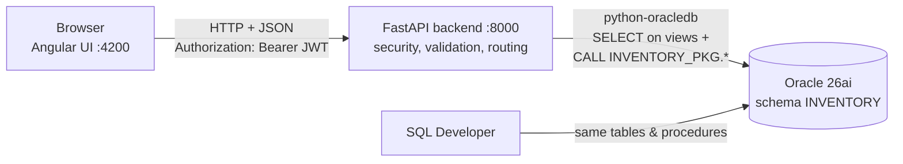

# StockSmart: Inventory Management System

An Information Systems course project built as a **3-tier web application**.

| Tier | Technology | Folder |
|---|---|---|
| Presentation (UI) | Angular 19 (TypeScript, SCSS, Chart.js) | `frontend/` |
| Application | Python FastAPI (REST API, JWT security) | `backend/app/` |
| Data + business rules | **Oracle Database** (26ai Free or 21c): tables, PL/SQL package `INVENTORY_PKG`, trigger, views | `database/` |



The Python API and SQL Developer both use **the same stored procedures**, so a stock change made in either place follows the same rules and shows up in the other straight away.

## Features

**Customer**
- Register and log in
- Pick an outlet, browse products with live stock, search and filter by category
- Add to cart and place an order. Stock is reserved straight away, so it can't be oversold.
- Payment gateway (card, UPI or net banking) with success and decline handling, plus retry
- Track orders (Packed → Shipped → Out for delivery → Delivered) and cancel before shipping, which returns the stock

**Admin**
- Dashboard: revenue, orders waiting to ship, pending payments, low-stock alerts
- Inventory: stock **per outlet**, **collective** totals across all outlets, stock value
- Update stock: **restock** (new arrival), **adjust** (damage or audit), **transfer** between outlets
- Stock movement log: every stock change is recorded with who made it, when and why
- Products: create, edit, hide (soft delete), with category, supplier and reorder level
- Orders: filter by payment, delivery status or outlet; update delivery status, courier and tracking number; cancel
- **Quarterly reports** with charts (by outlet, month, category, product), **downloadable as Excel or CSV**

## How to run

> **Easiest way (Windows):** download **[run-local.zip](https://github.com/VicodinAbuser/IS-Project/raw/main/run-local.zip)**. It's a self-contained copy of everything needed to run on a laptop, with double-click scripts. Then follow [run-local/README.md](run-local/README.md).
>
> *For developers:* the code is edited in `backend/`, `frontend/` and `database/`. After changing it, run `python tools/build_run_local.py` to refresh `run-local/` and `run-local.zip`.

You need:
- **Oracle AI Database 26ai Free** *or* **Oracle Database 21c** (both tested), installed on the laptop, and **Oracle SQL Developer** (Oracle's tool; MySQL Workbench can't open Oracle databases). No environment variables needed.
- **Python 3.10+**
- **Node.js 18+**

Oracle runs **locally on your laptop**; nothing is in the cloud.
**First time? Follow the full step-by-step guide with troubleshooting: [docs/ORACLE_SETUP.md](docs/ORACLE_SETUP.md).**

### 1. Database (one-time, in SQL Developer)
1. Connect as **SYSTEM**. Host `localhost`, port `1521`, **Service name** `FREEPDB1` (26ai) or `ORCLPDB` (21c).
2. Open `database/00_create_user.sql` and run it as a script (**F5**). This creates the `INVENTORY` user, plus `INVENTORY_TEST` for automated tests. It's safe to run again.
3. Create a new connection as **INVENTORY** / `inventory123`, with the same host, port and service.
4. In that connection, run these files in order with **F5**:

| File | What it creates |
|---|---|
| `database/01_schema.sql` | 11 tables, constraints, indexes |
| `database/02_inventory_pkg.sql` | PL/SQL package `INVENTORY_PKG`, trigger `TRG_INVENTORY_AUDIT`, 4 views |
| `database/03_seed_data.sql` | Demo data: 13 products, 4 outlets, about 260 orders over two years |

Shortcut: after installing the backend packages (below), `python setup_db.py --create-user` does steps 2–4 for you. It asks for the SYSTEM password.

If your port, service name or password is different, copy `backend/.env.example` to `backend/.env` and edit it.

### 2. Backend (port 8000)
```bash
cd backend
python -m venv .venv
# Windows: .venv\Scripts\activate     Mac/Linux: source .venv/bin/activate
pip install -r requirements.txt
uvicorn app.main:app --reload
```
Interactive API docs (good for the demo): http://localhost:8000/docs

### 3. Frontend (port 4200), in a second terminal
```bash
cd frontend
npm install
npm start
```
Open http://localhost:4200

| Demo login | Email | Password |
|---|---|---|
| Admin | admin@inventory.com | admin123 |
| Customer | customer@inventory.com | customer123 |

Payment test rule: a card ending in `0000`, or a UPI ID starting with `fail`, is **declined**. Anything else succeeds.

### Tests
```bash
cd backend && pytest -q        # API tests on a real Oracle DB (uses the INVENTORY_TEST schema)
cd frontend && npm test        # Angular unit tests (*.spec.ts)
```

### Optional: put the website online with Vercel
The Angular site can be hosted on Vercel while the backend and Oracle stay on your laptop, reached through a free tunnel. See **[docs/DEPLOY_VERCEL.md](docs/DEPLOY_VERCEL.md)**.

## Presentation demo with SQL Developer
Open `database/04_demo_queries.sql` while the website is running. It walks through:
1. Showing every table, view, package and trigger, all VALID
2. Stock per outlet, low-stock alerts, collective stock, quarterly sales, straight from the views
3. **Database → website**: `EXEC inventory_pkg.restock(...)` in SQL Developer, then refresh the Inventory page and +50 appears
4. The trigger logged it automatically in `STOCK_MOVEMENTS`. Even a plain `UPDATE` is logged, as `MANUAL`.
5. A business rule enforced by Oracle: ordering 9,999 units fails with `ORA-20001: Not enough stock`, and nothing is saved
6. Placing an order from PL/SQL. It then appears in the customer's "My orders" page.
7. **Website → database**: buy in the browser, then `SELECT` the new order in SQL Developer

## Data model (ER diagram)

```mermaid
erDiagram
  USERS ||--o{ ORDERS : places
  OUTLETS ||--o{ ORDERS : fulfils
  OUTLETS ||--o{ INVENTORY : holds
  PRODUCTS ||--o{ INVENTORY : "stocked as"
  CATEGORIES ||--o{ PRODUCTS : groups
  SUPPLIERS ||--o{ PRODUCTS : supplies
  ORDERS ||--|{ ORDER_ITEMS : contains
  PRODUCTS ||--o{ ORDER_ITEMS : "sold in"
  ORDERS ||--|| PAYMENTS : "paid by"
  ORDERS ||--|| DELIVERIES : "shipped by"
  PRODUCTS ||--o{ STOCK_MOVEMENTS : logs
  OUTLETS ||--o{ STOCK_MOVEMENTS : logs

  USERS { int id PK; string email UK; string password_hash; enum role "ADMIN|CUSTOMER" }
  OUTLETS { int id PK; string name UK; string city }
  PRODUCTS { int id PK; string sku UK; string name; decimal price; int reorder_level; bool is_active; int category_id FK; int supplier_id FK }
  INVENTORY { int id PK; int product_id FK; int outlet_id FK; int quantity "CHECK >= 0, UNIQUE(product,outlet)" }
  STOCK_MOVEMENTS { int id PK; int change; enum movement_type; int order_id FK; int user_id FK; datetime created_at }
  ORDERS { int id PK; int customer_id FK; int outlet_id FK; enum status; decimal total_amount; datetime created_at }
  ORDER_ITEMS { int id PK; int order_id FK; int product_id FK; int quantity; decimal unit_price }
  PAYMENTS { int id PK; int order_id FK "UNIQUE"; enum status; string method; string transaction_ref }
  DELIVERIES { int id PK; int order_id FK "UNIQUE"; enum status; string courier; string tracking_number }
  CATEGORIES { int id PK; string name UK }
  SUPPLIERS { int id PK; string name UK }
```

(The database table names are `APP_USERS`, `OUTLETS`, `PRODUCTS` and so on. Primary keys are `<table>_id` identity columns.)

Design decisions worth explaining:
- **`inventory` is a junction table** between products and outlets, which gives one stock row per product per outlet. Collective stock is just `SUM(quantity) GROUP BY product`.
- **`stock_movements` is an audit log** filled by trigger `TRG_INVENTORY_AUDIT` on every change to `inventory.quantity`. The stock level and its history can't drift apart, even with manual SQL.
- **`order_items.unit_price`** stores the price *at the time of purchase*, so later price changes don't rewrite old reports.
- **Constraints in the database**: `quantity >= 0`, `price >= 0`, allowed status values, unique SKU and email, and foreign keys. Even buggy code can't save invalid data.
- **Indexes** on `orders(created_at, status)`, `sku`, `email` and `stock_movements.created_at` keep reports and lookups fast.
- **Normalised to 3NF**: no repeated product or outlet data inside orders.

## PL/SQL package `INVENTORY_PKG`

| Procedure / function | What it does | Called by API endpoint |
|---|---|---|
| `restock(product, outlet, qty, note, user)` | New stock arrives | `POST /api/inventory/restock` |
| `adjust_stock(product, outlet, change, note, user)` | Damage or audit correction (+/−) | `POST /api/inventory/adjust` |
| `transfer_stock(product, from, to, qty, note, user)` | Moves stock between outlets in one transaction | `POST /api/inventory/transfer` |
| `place_order(customer, outlet, address, items_json, OUT order_id)` | First expires abandoned checkouts, then checks and reserves stock, and creates order, items, payment and delivery rows. All or nothing. | `POST /api/orders` |
| `record_payment(order, method, success, txn_ref)` | Saves the gateway result. On success: PAID and PACKED. | `POST /api/orders/{id}/pay` |
| `cancel_order(order, user)` | Before shipping only: returns stock. Payment becomes REFUNDED if paid, CANCELLED if not. | `POST /api/orders/{id}/cancel` |
| `update_delivery(order, status, courier, tracking)` | Delivery tracking (paid orders only). Status can only move **forward**. **RETURNED** (after shipping) restocks the items and refunds. | `PATCH /api/orders/{id}/delivery` |
| `expire_unpaid_orders(minutes, OUT count)` | Cancels orders left unpaid for 30+ minutes, so abandoned checkouts don't hold stock | called by `place_order` |
| `stock_at(product, outlet)` / `total_stock(product)` | Functions used inside the product `SELECT` | `GET /api/products` |
| `change_stock(...)` | Core rule used by all of the above: locks the row, checks stock, updates it | (internal) |

Errors are raised with `RAISE_APPLICATION_ERROR`, and the API translates them into HTTP status codes:

| Oracle error | Meaning | HTTP |
|---|---|---|
| `ORA-20001` | Not enough stock | 409 |
| `ORA-20004` | Not found | 404 |
| `ORA-20009` | Wrong state (e.g. order already shipped) | 409 |
| `ORA-20022` | Bad input | 422 |

**Views** used by the API: `V_INVENTORY_STATUS` (stock + low-stock flag), `V_PRODUCT_STOCK` (collective totals), `V_SALES_LINES` (paid order lines with year, quarter and month), `V_QUARTERLY_SALES`.

## REST API (backend ↔ UI contract)

| Method | Endpoint | Who | Purpose |
|---|---|---|---|
| POST | `/api/auth/register`, `/api/auth/login` | public | Returns a JWT and the user |
| GET | `/api/products?search=&category_id=&outlet_id=` | logged in | Catalogue with stock |
| POST/PUT/DELETE | `/api/products[/id]` | admin | Manage products |
| GET | `/api/outlets`, `/api/categories` | public | Lookups |
| GET | `/api/inventory?outlet_id=` | admin | Stock per outlet |
| GET | `/api/inventory/summary` | admin | Collective stock across outlets |
| GET | `/api/inventory/low-stock` | admin | Items at or below reorder level |
| POST | `/api/inventory/restock` · `/adjust` · `/transfer` | admin | Update stock |
| GET | `/api/inventory/movements` | admin | Audit log |
| POST | `/api/orders` | customer | Place order (reserves stock) |
| GET | `/api/orders/my` · `/api/orders` | customer · admin | List orders |
| POST | `/api/orders/{id}/pay` | owner | Payment gateway |
| POST | `/api/orders/{id}/cancel` | owner/admin | Cancel, return stock, refund |
| PATCH | `/api/orders/{id}/delivery` | admin | Delivery status and tracking |
| GET | `/api/reports/dashboard` | admin | KPI numbers |
| GET | `/api/reports/quarterly?year=&quarter=` | admin | Report JSON for charts |
| GET | `/api/reports/quarterly/export?format=xlsx\|csv` | admin | Download the report |

## Project structure

```
database/
  00_create_user.sql       run as SYSTEM: creates the INVENTORY schema
  01_schema.sql            tables, constraints, indexes
  02_inventory_pkg.sql     PL/SQL package, audit trigger, views (the business logic)
  03_seed_data.sql         demo data
  04_demo_queries.sql      queries for the live presentation
backend/
  app/main.py              FastAPI app, CORS, Oracle error → HTTP mapping
  app/config.py            settings (Oracle DSN/user, JWT secret), overridable with .env
  app/database.py          Oracle connection pool + query / call_procedure helpers
  app/schemas.py           request/response validation (Pydantic)
  app/security.py          bcrypt hashing, JWT creation/verification, admin check
  app/routers/             auth, catalog, inventory, orders, reports endpoints
  setup_db.py              runs the database/*.sql files from Python
  tests/test_api.py        automated API tests against Oracle
frontend/src/
  index.html, styles.scss  page shell + global design system
  environments/            API base URL
  app/app.routes.ts        URL → page mapping, guarded by role
  app/core/                api.service (all HTTP calls), auth.service, cart.service,
                           auth.interceptor (adds JWT), guards, models (TS interfaces)
  app/components/navbar/   role-aware navigation
  app/pages/               login, register, shop, cart, checkout, my-orders
  app/pages/admin/         dashboard, products, inventory, orders, reports
  (each component = .ts logic + .html template + .scss styles + .spec.ts test)
```

## Viva / Q&A preparation

**How is the database connected to the backend?**
`app/database.py` uses **python-oracledb**, Oracle's official Python driver. In its "thin" mode no Oracle Client install is needed. When the server starts, it opens a **connection pool** to `localhost:1521/FREEPDB1` (or `ORCLPDB` on 21c, from `backend/.env`) as user `INVENTORY`. Each API request borrows one connection through FastAPI's dependency injection (`Depends(get_db)`) and returns it afterwards.
- **Reads** are plain SQL `SELECT`s, mostly on the views. For example, `SELECT * FROM v_inventory_status WHERE outlet_id = :outlet_id`.
- **Writes** call the PL/SQL package, e.g. `cursor.callproc("inventory_pkg.restock", keyword_parameters={...})`.
- All values are passed as **bind variables** (`:name`), never pasted into the SQL text. This prevents SQL injection and lets Oracle reuse execution plans.

**Why put business logic in PL/SQL?**
The rules sit next to the data. Every client follows the same rules: the website, SQL Developer and any future mobile app. The work also happens in one round trip to the database, and the transaction is handled inside Oracle (`COMMIT` on success, `ROLLBACK` on any error).

**How does the UI sync with the backend?**
Angular components call `ApiService`, which uses `HttpClient` to send JSON over HTTP to the REST endpoints. `authInterceptor` adds the `Authorization: Bearer <JWT>` header to every request. Responses are typed with the interfaces in `models.ts`, which mirror the backend's Pydantic schemas. After any change, such as a restock, the component fetches the data again, so the screen always shows what's in the database. CORS in `main.py` allows the UI's origin (port 4200) to call the API (port 8000).

**How is the UI developed?**
It uses standalone Angular components. Each page has a `.ts` class (state held in *signals*, plus event handlers), an `.html` template (Angular control flow `@if`/`@for`, data binding), an `.scss` file for styles and a `.spec.ts` test. Routing in `app.routes.ts` uses *guards* to block customers from admin pages. Forms use Reactive Forms with validators, and charts use Chart.js.

**What security is implemented?**
- Passwords are hashed with **bcrypt** and never stored as plain text.
- Login returns a signed **JWT** that expires after 2 hours.
- **Role-based access control**: `require_admin` blocks customers from admin APIs with HTTP 403, and customers can only see their own orders.
- Public sign-up can only create customers.
- All input is validated by Pydantic, and the database adds its own CHECK and UNIQUE constraints.
- The ORM uses parameterised queries, which blocks SQL injection.
- Route guards on the UI are for convenience only. The real enforcement happens on the server.

**How do you prevent overselling?**
`INVENTORY_PKG.PLACE_ORDER` runs as **one transaction**. For each item, `change_stock` locks the stock row with `SELECT … FOR UPDATE`, so two people buying at the same moment can't both take the last unit. If any item is short, Oracle raises `ORA-20001` and the procedure runs `ROLLBACK`, so nothing is saved (all or nothing). Items are processed in product-ID order to avoid deadlocks. The `CHECK (quantity >= 0)` constraint is a final safety net.

**What are the order rules?**
- **Order:** `PENDING_PAYMENT` → `PAID` → (`CANCELLED` before shipping, or `RETURNED` after shipping).
- **Delivery:** `PACKED` → `SHIPPED` → `OUT_FOR_DELIVERY` → `DELIVERED`, and it can only move forward. Otherwise a delivered order could be moved back and cancelled for a refund.
- **Abandoned checkouts:** unpaid orders are cancelled automatically after 30 minutes so their stock goes back on sale.
- These rules live in `INVENTORY_PKG`, so they also apply in SQL Developer.

**What does the trigger do?**
`TRG_INVENTORY_AUDIT` fires `AFTER INSERT OR UPDATE OF quantity ON inventory FOR EACH ROW` and writes the change to `STOCK_MOVEMENTS`. The procedures first fill package variables (movement type, user, order, note) so the trigger knows *why* the stock changed. If someone runs a plain `UPDATE`, those variables are empty and the change is logged as `MANUAL`, along with the database user's name.

**What happens when stock changes?**

| Event | Stock change | Movement type |
|---|---|---|
| New stock arrives | + | RESTOCK |
| Customer orders | − | SALE |
| Order cancelled, or unpaid for 30 minutes | + | CANCEL |
| Shipped order returned | + | RETURN |
| Damage or audit | ± | ADJUSTMENT |
| Moved between outlets | − / + | TRANSFER_OUT / TRANSFER_IN |

**How are quarterly reports made?**
The view `V_SALES_LINES` joins paid orders, items, products, outlets and categories, and adds `sales_year` / `sales_quarter` / `sales_month` columns. The API runs `GROUP BY` aggregates (`SUM`, `COUNT DISTINCT`) on it for the chosen quarter. The results go to the UI as JSON for the charts, and **openpyxl** builds the Excel file for download.

**Why FastAPI rather than Java Spring Boot?**
It needs far less code, validates data automatically, generates Swagger docs at `/docs`, and is one of the fastest Python frameworks. The 3-tier design would be identical in Spring Boot: controllers = routers, DTOs = schemas, and JDBC `CallableStatement` = `callproc`.

**How would this go to production?**
- Point `ORACLE_DSN` at the production database, use a strong password and a least-privilege account (e.g. a user that can only `EXECUTE` the package and `SELECT` the views).
- Set a strong `JWT_SECRET`.
- Use a real payment gateway (Razorpay or Stripe) with webhook signature verification.
- Run with `ng build` + Nginx and `uvicorn` behind HTTPS.
- Keep the `database/*.sql` scripts in version control as migration steps.

## SDLC phases (for the presentation)
1. **Planning**: problem (stock spread across outlets, manual tracking), scope, two user roles
2. **Requirements**: the feature lists above (functional); security, speed and auditability (non-functional)
3. **Design**: 3-tier architecture, ER diagram, REST API contract, UI screens
4. **Development**: database first (tables → PL/SQL package → views), then API routers, then Angular pages
5. **Testing**: pytest API tests on real Oracle (including 8 simultaneous buyers, access control, returns, abandoned checkouts), Angular unit tests, SQL demo script, end-to-end browser test
6. **Deployment and maintenance**: production checklist above

Screenshots of every page are in `docs/screenshots/`.
